# Rapport d'usage de l'IA, TP1

Pour chaque mission je détaille l'objectif, le prompt principal, le plan proposé par l'agent, les vérifications que j'ai faites, les erreurs ou propositions rejetées, les fichiers vraiment modifiés, la preuve que ça marche, et ce que je sais maintenant expliquer sans l'agent.

Modèle utilisé, Claude Sonnet 5 (`claude-sonnet-5`) via Claude Code.

J'ai fait ce premier TD seul, pas encore en binôme.

## Mission 0, cartographie de l'application

Objectif

Comprendre comment le projet frontend est organisé (composant racine, routes, HttpClient, services, JWT) sans toucher au code, et faire un schéma du flux de connexion.

Prompt principal

C'est moi qui ai donné la direction. Explorer `frontend-starter/src/` sans rien modifier, m'expliquer un par un les points demandés par le sujet, et me générer le schéma du flux de connexion directement en HTML plutôt que d'aller sur un site externe pour faire un diagramme. Comme ça j'ai un fichier prêt à ouvrir, sans dépendre d'un outil en ligne.

Plan proposé par l'agent

Lire les fichiers clés (`main.ts`, `app.ts`, `routes.ts`, les intercepteurs, les services, les pages), comparer avec `API_CONTRACT.md`, puis rédiger les notes et le schéma.

Vérifications réalisées par moi

Le contenu des notes vient de ce que j'ai compris moi même en explorant le projet. Le premier jet me convenait pas, donc j'ai demandé de le reformuler plus simplement, plus proche de comment je parle, pour que ce soit plus clair et plus facile à réviser. C'était pas pour qu'il comprenne à ma place. J'ai aussi ouvert le schéma HTML dans le navigateur pour vérifier qu'il s'affiche bien.

Erreurs ou propositions rejetées

Le premier jet des notes était trop formel à mon goût, j'ai demandé de le réécrire dans un langage plus simple.

Fichiers effectivement modifiés

Aucun fichier de code, c'était une mission d'exploration comme demandé. J'ai créé `TP1_MISSIONS.md` et `schema-flux-connexion.html`.

Preuve de fonctionnement

Pas de code à tester pour cette mission. Le schéma HTML s'ouvre et s'affiche correctement.

Ce que je sais maintenant expliquer sans l'agent

Le rôle du composant racine et du `router-outlet`, comment `authGuard` protège les routes, comment l'intercepteur ajoute tout seul le JWT aux requêtes, où le token est stocké (localStorage et Signal), et la différence entre routes publiques et protégées côté API.

## Mission 1, inscription, connexion et profil

Objectif

Compléter la partie utilisateur du frontend selon la checklist du sujet (formulaires, validations, JWT, déconnexion, profil, gestion du 401), en modifiant seulement ce qui manquait ou qui était pas optimal, vu que le starter en faisait déjà une bonne partie.

Prompt principal

J'ai donné la méthode. Reprendre les points du sujet un par un dans l'ordre, vérifier l'état réel de chaque point dans le code plutôt que de supposer, modifier seulement ce qui était vraiment nécessaire, me montrer le code avant de l'appliquer, et documenter chaque changement dans `TP1_MISSIONS.md` avec mes mots pour que je puisse tout réexpliquer.

Plan proposé par l'agent

Passer les 10 points du sujet un par un (formulaires, validations, appels API, stockage du JWT, Signal `currentUser`, redirections, bouton de déconnexion, chargement du profil, modification du profil, gestion du 401), vérifier ce qui existait déjà avant de coder, et attendre ma validation avant chaque modification.

Vérifications réalisées par moi

Pour chaque modification proposée (validations du formulaire d'inscription, bouton de déconnexion, chargement auto du profil, intercepteur 401), j'ai lu le code avant et après et j'ai validé avant que ce soit appliqué. J'ai demandé de garder le bouton "Charger mon profil" en plus du chargement automatique. J'ai aussi fait vérifier avec un `grep` qu'aucun composant appelle `HttpClient` directement. Les explications dans `TP1_MISSIONS.md` viennent de ce que j'ai compris en suivant chaque étape, et j'ai demandé une reformulation à chaque fois que c'était pas assez clair pour moi.

Erreurs ou propositions rejetées

Rien de rejeté sur le fond du code, mais j'ai ajusté un point. Le bouton manuel pour recharger le profil devait être supprimé, j'ai préféré le garder pour pouvoir recharger à la main si besoin.

Fichiers effectivement modifiés

`register-page.ts` et `register-page.html` pour les validations du formulaire, `app.ts` et `app.html` pour le bouton de déconnexion, `profile-page.ts` pour le chargement automatique du profil, `main.ts` et le nouveau `error.interceptor.ts` pour la gestion du 401.

Preuve de fonctionnement

Compilation Angular réussie à chaque étape (logs de `ng serve` vérifiés). Côté backend, tests avec `curl`. Une inscription avec un mot de passe trop court renvoie 400, une inscription valide renvoie 201 avec un token, le login renvoie un token, `GET /api/users/me` avec un token valide renvoie 200 et avec un token invalide 401. Mes captures Network (le détail de chaque requête est dans la partie Checkpoint de `TP1_MISSIONS.md`).

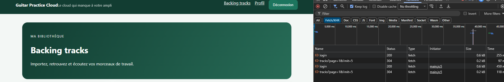

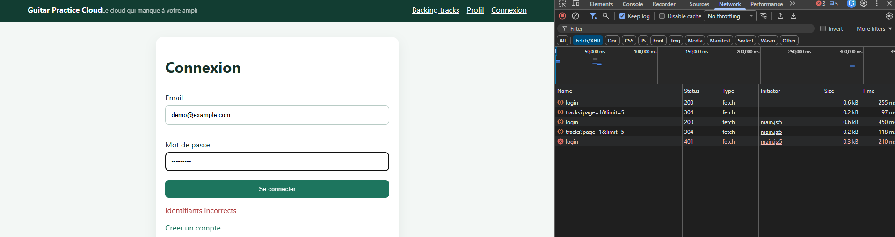

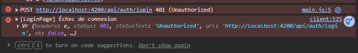

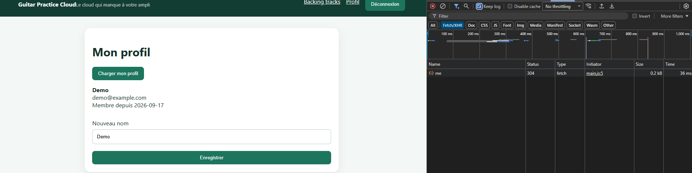

Pour l'intercepteur 401, j'ai mis un faux token dans le localStorage puis je suis allé sur /profile. Le GET /api/users/me répond 401 et je suis renvoyé sur /login. Le token visible c'est le faux. Cette capture je l'avais pas faite au moment du TP1, je l'ai prise après le redesign du TP3, donc elle a le nouveau design.

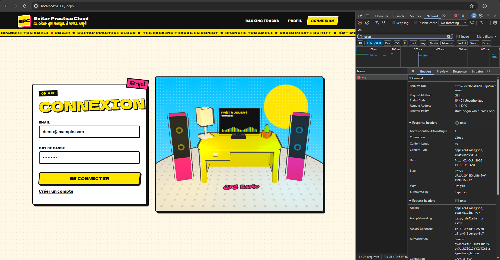

Ce que je sais maintenant expliquer sans l'agent

Pourquoi les validations du formulaire côté front doivent correspondre aux règles du backend, comment marche l'intercepteur qui ajoute le JWT à chaque requête, pourquoi il fallait un intercepteur séparé pour les réponses 401, où se trouve la logique de mise à jour du profil côté back (`app.js`) et côté front (`auth.service.ts` et `profile-page.ts`), et pourquoi les composants doivent jamais appeler `HttpClient` directement.

# Rapport d'usage de l'IA, TP2

Modèle utilisé, Claude Opus 5.5 (`claude-opus-5-5`) via Claude Code.

Les explications détaillées de chaque mission sont dans `TP2_MISSIONS.md`.

## Mission 2, bibliothèque paginée

Objectif

Avoir une bibliothèque paginée côté serveur, avec les Signals `tracks`, `page`, `pages`, `loading` et l'erreur, `@for`, `@empty` et `@if` dans le template, et des boutons Précédent et Suivant désactivés aux bornes, sans modifier le backend et sans découper la liste côté Angular.

Prompt principal

J'ai repris la même méthode qu'au TP1. D'abord ranger mes fichiers audio de test au bon endroit, puis vérifier point par point ce que le starter faisait déjà pour la Mission 2, compléter seulement ce qui manquait, et tout documenter dans `TP2_MISSIONS.md` et ici en m'expliquant clairement chaque étape.

Plan proposé par l'agent

Lire `track.service.ts`, `tracks-page.ts/html` et la route `GET /api/tracks` dans `app.js` pour voir comment le backend calcule `pages`, ajouter le signal d'erreur qui manquait, séparer l'affichage du chargement et de la liste, renommer et sécuriser les boutons de pagination, et tester la pagination sur le vrai backend.

Vérifications réalisées par moi

J'ai vérifié dans le backend que `pages` vaut toujours au moins 1, donc pas de bug avec une bibliothèque vide, contrairement à ce qu'on pensait au départ. J'ai relu les modifications du composant et du template avant de les garder. La pagination a été testée sur le backend en local avec `page=1`, `2` et `3`, et les logs du serveur montrent bien une requête différente à chaque page.

Erreurs ou propositions rejetées

L'hypothèse d'un bug du bouton Suivant avec une bibliothèque vide a été écartée après lecture du backend. Au début l'agent avait fini la mission de base sans les options avancées. Je lui ai demandé de confirmer, il a reconnu qu'elles étaient pas faites et on les a planifiées puis faites dans un second temps (en mode plan). Pour le Paginator, j'ai choisi de remplacer nos boutons au lieu de garder les deux. J'ai aussi demandé de passer tout le TP2 sur une branche `tp2` au lieu de `main`. Pendant la mise en place du style Material, une première règle CSS aurait écrasé les styles de Material, elle a été corrigée avec `:where()`.

Fichiers effectivement modifiés

Pour la mission de base, `tracks-page.ts` (signal `error`, garde contre les doubles chargements) et `tracks-page.html` (affichage de l'erreur, `@if` et `@else` pour le chargement). Pour l'option Mongoose, `backend/src/models/Track.js` (plugin), `backend/src/app.js` (route `GET /api/tracks` en aggregate), `backend/test/api.test.js`, `backend/package.json` et `API_CONTRACT.md`. Pour l'option Material, `frontend-starter/package.json`, `angular.json` (thème), `styles.css`, `main.ts`, le nouveau `shared/i18n/paginator-intl.ts`, `shared/models/page.model.ts`, et `tracks-page.ts/html/css` (`mat-paginator`, signaux `limit` et `total`, `onPage()`). J'ai ajouté les fichiers de test `coffee-time.mp3` et `summer-breeze.mp3` dans `frontend-starter/fichiers-audio-de-test/`. `track.service.ts` a pas eu besoin d'être modifié.

Preuve de fonctionnement

Build Angular sans erreur, et dans les logs backend `[tracks] Lecture page=1, limit=5`, puis `page=2`, puis `page=3` pendant les tests. Mes captures avec 6 pistes sur le compte.

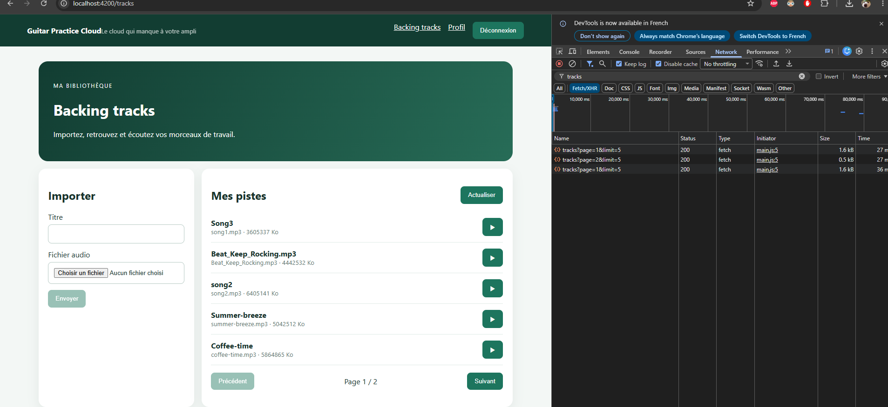

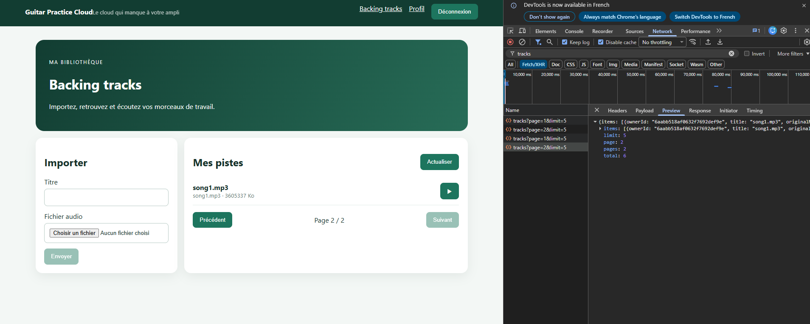

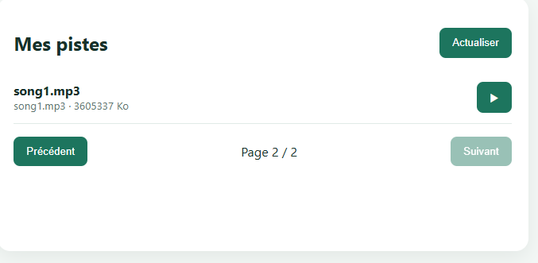

Pour les options avancées, `npm test` du backend passe (3 tests sur 3), et les appels `curl` sur la nouvelle route renvoient `total` à 6, `pages` à 2, `hasNextPage` et `hasPrevPage` corrects, sans `storedName` ni `_id`, et 401 sans token. Le build avec Material passe sans erreur, et j'ai vérifié le rendu dans le navigateur.

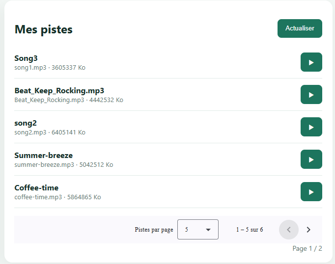

Ce que je sais maintenant expliquer sans l'agent

La différence entre une pagination serveur (`skip` et `limit` avec `countDocuments` dans Mongo) et un découpage côté client, pourquoi chaque clic sur Précédent ou Suivant doit refaire une requête HTTP, comment les Signals pilotent l'affichage du template (`@if`, `@for`, `@empty`), et pourquoi on désactive les boutons pendant un chargement. Pour les options avancées, ce que fait un pipeline d'agrégation (`$match`, `$sort`, `$project`) et pourquoi il faut convertir l'id en `ObjectId` à la main, à quoi servent les `customLabels` du plugin pour pas casser le contrat, pourquoi le Paginator compte à partir de 0 alors que l'API commence à 1, et comment `MatPaginatorIntl` permet de traduire le composant.

## Mission 3, upload et lecture audio

Objectif

Repérer où se passent le choix du fichier, le `FormData`, l'upload, le `Blob`, l'`ObjectURL`, le lecteur et la révocation, expliquer l'intercepteur JWT et les contrôles du backend, puis compléter seulement ce qui manquait côté frontend (validation avant envoi, états pendant l'upload, cards accessibles, morceau en cours, erreurs audio, révocation finale) et répondre aux questions sur la mémoire, le buffering et le streaming.

Prompt principal

Je voulais que la Mission 3 soit faite comme la 2. D'abord repérer dans le code ce qui existait déjà côté backend et frontend, rien refaire et pas toucher au contrat HTTP, compléter le front point par point avec un commit par fonctionnalité sur la branche `tp2`, et tout expliquer dans `TP2_MISSIONS.md` avec mes mots.

Plan proposé par l'agent

Lire `app.js` (Multer, `allowed`, `MAX_FILE_SIZE`, routes d'upload et d'audio, gestionnaire d'erreurs), `track.service.ts`, `auth.interceptor.ts` et `tracks-page`, créer un validateur partagé qui reprend les règles du backend, ajouter les signaux de l'upload, transformer la liste en cards avec des pipes de formatage, compléter la lecture, vérifier les points du checkpoint avec `curl`, puis rédiger l'analyse et les réponses.

Vérifications réalisées par moi

J'ai relu les modifications et les explications. Les points du checkpoint ont été vérifiés côté serveur avec `curl`. Un fichier texte renvoie 400 « Format audio non accepté », un envoi sans fichier renvoie 400 « Fichier audio requis », la lecture renvoie 200 en `audio/mpeg` avec `Accept-Ranges` à bytes, une demande `Range` renvoie 206 Partial Content, sans token on a 401, et avec le token d'un deuxième compte de test la piste du compte demo renvoie 404. Ensuite j'ai vérifié le rendu dans le navigateur et fait les captures Network.

Erreurs ou propositions rejetées

Une première version utilisait un seul signal d'erreur pour la validation et pour les erreurs serveur. Ça bloquait le bouton Envoyer après une erreur serveur, donc on a séparé `fileError` et `uploadError`. Mettre le token dans l'URL du `<audio>` a été écarté, parce qu'il finirait dans l'historique et dans les logs.

Fichiers effectivement modifiés

`tracks-page.ts`, `tracks-page.html`, `tracks-page.css`, `styles.css`, et les nouveaux fichiers `shared/validators/audio-file.ts`, `shared/pipes/file-size.pipe.ts` et `shared/pipes/audio-format.pipe.ts`. Aucun fichier backend ni `track.service.ts` modifié pour cette mission.

Preuve de fonctionnement

Build Angular sans erreur et tests `curl` au dessus. Mes captures dans le navigateur.

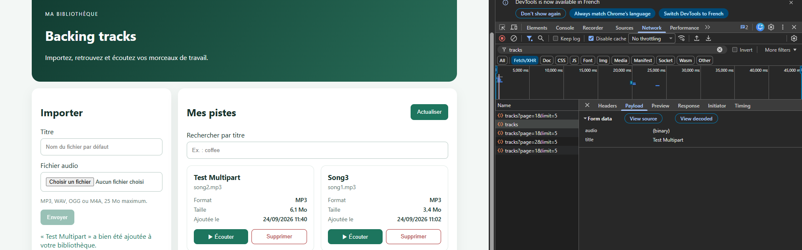

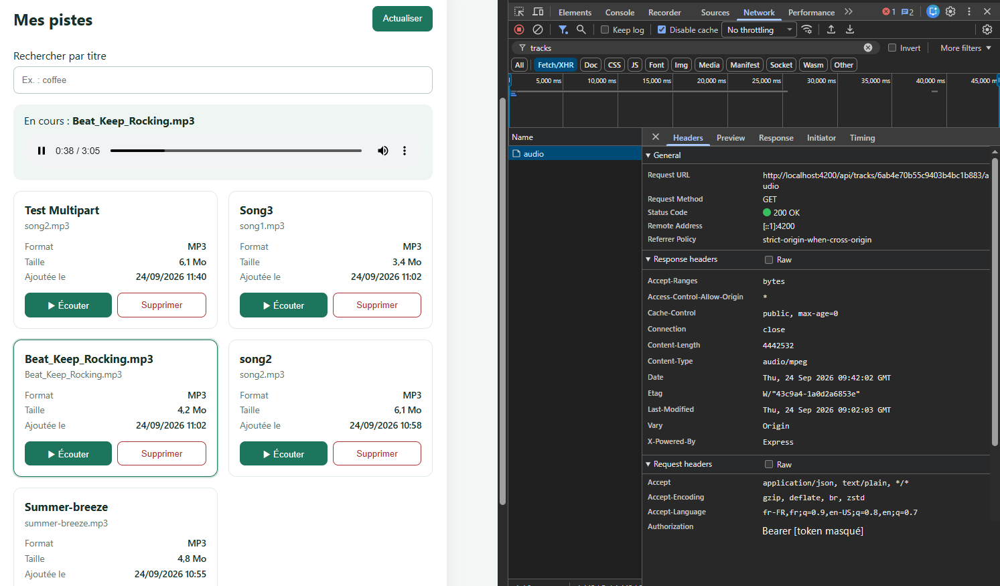

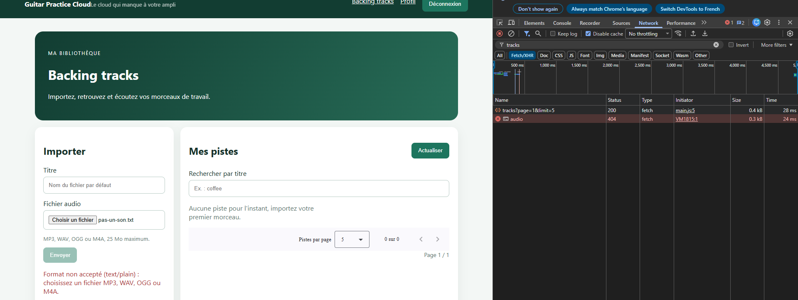

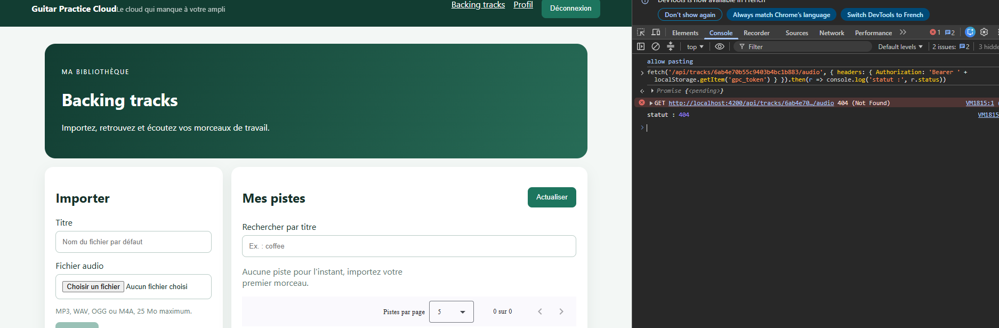

Ce que je sais maintenant expliquer sans l'agent

Le trajet d'un fichier depuis l'input jusqu'au disque du serveur et à MongoDB, pourquoi un `src` direct envoie pas le JWT et comment `Blob` et `ObjectURL` contournent le problème, pourquoi la validation frontend remplace jamais celle du backend, la différence entre télécharger un Blob complet, le buffering du navigateur et le streaming côté serveur (requêtes `Range`, réponse 206), et pourquoi il faut révoquer une `ObjectURL` dans une SPA.

## Améliorations facultatives

Objectif

Faire toutes les améliorations facultatives du sujet, donc la barre de progression de l'upload, la suppression avec confirmation, le rafraîchissement après suppression, le formatage lisible de la taille et de la date (déjà fait en Mission 3), et le filtre par titre.

Prompt principal

J'ai demandé de faire toutes les améliorations facultatives, sans pousser directement, en me demandant mon avis sur les choix à faire et en m'expliquant chaque étape.

Plan proposé par l'agent

Une amélioration par commit. `reportProgress` avec `observe` à 'events' pour la progression, la route `DELETE` qui existait déjà avec une dialog de confirmation, un paramètre `?q=` côté serveur pour le filtre, et des tests `curl` à chaque étape.

Vérifications réalisées par moi

L'agent m'a posé deux questions et c'est moi qui ai choisi. Une dialog Angular Material plutôt que `window.confirm()`, et un filtre côté serveur (`?q=`) plutôt qu'un filtre sur la page affichée, pour garder une vraie pagination serveur. Tests `curl`, la suppression donne 204 puis 404 et la liste est mise à jour, le filtre ignore les majuscules, les caractères spéciaux sont échappés (`.*` renvoie rien, `(` fait pas planter le serveur), et un `q` envoyé en double est ignoré. `npm test` du backend passe. J'ai ensuite vérifié le rendu dans le navigateur avec les captures.

Erreurs ou propositions rejetées

Le filtre sur la page affichée seulement a été écarté, parce qu'il trouve pas les pistes des autres pages et qu'il ressemble au découpage local interdit par le sujet. `window.confirm()` a été écarté au profit de la dialog Material.

Fichiers effectivement modifiés

`track.service.ts` (`upload` avec les événements de progression, `remove`, `list` avec `q`), `tracks-page.ts/html/css`, le nouveau `shared/components/confirm-dialog/confirm-dialog.ts`, `backend/src/app.js` (paramètre `q` sur `GET /api/tracks`) et `API_CONTRACT.md`.

Preuve de fonctionnement

Build Angular sans erreur, tests backend 3 sur 3, et tests `curl` au dessus. Mes captures.

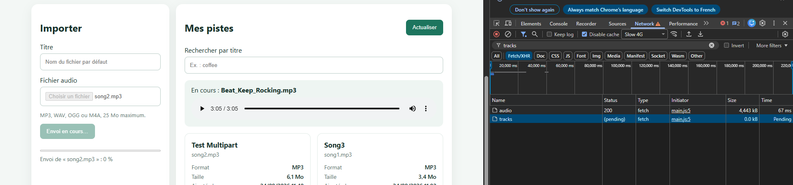

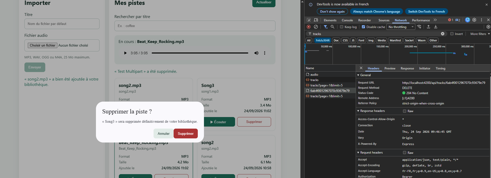

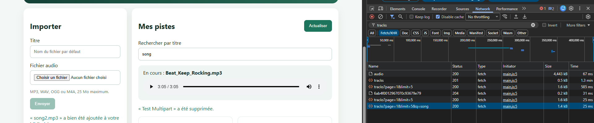

Ce que je sais maintenant expliquer sans l'agent

Comment `reportProgress` et `HttpEventType` permettent de suivre un upload, comment une `MatDialog` renvoie un résultat avec `afterClosed()`, pourquoi un filtre doit être fait côté serveur quand la liste est paginée, pourquoi il faut échapper une saisie avant d'en faire une regex MongoDB, et à quoi servent `debounceTime`, `distinctUntilChanged` et l'annulation de la requête précédente.

## AVANCÉ, image de couverture

Objectif

Ajouter une image de couverture à chaque morceau, en identifiant d'abord les changements dans les données et dans l'API, et en respectant la sécurité, l'accessibilité et les droits sur les images.

Prompt principal

J'ai demandé de faire l'image de couverture en me laissant choisir l'approche, puis de passer en mode plan pour me présenter les changements de données et d'API avant de coder, comme le demande le sujet.

Plan proposé par l'agent

Deux champs dans `Track` (`coverName` masqué et `coverType`) et un booléen public `hasCover`, deux nouvelles routes `PUT` et `GET /api/tracks/:id/cover` sans toucher à `POST /api/tracks`, une deuxième config Multer (JPEG, PNG, WebP, 2 Mo, pas de SVG) avec vérification des premiers octets, et côté front un champ facultatif dans le formulaire, un bouton sur chaque card et l'affichage en Blob avec ObjectURL et révocation.

Vérifications réalisées par moi

C'est moi qui ai choisi l'upload d'image plutôt que les tags ID3 et un service web. J'ai validé le plan (données et API) avant qu'il soit codé. Tests `curl`, une vraie image donne 200, la lecture se fait en `image/png` avec `nosniff`, un faux PNG donne 400, une image trop grosse 400, un SVG 400, sans fichier 400, sans token 401, et le compte demo 404. Aucun fichier orphelin dans `data/uploads` après un refus, un remplacement ou une suppression. `npm test` passe, 4 tests sur 4. Build Angular sans erreur.

Erreurs ou propositions rejetées

L'approche ID3 et service web a été écartée à ce moment là (dépendance externe, droits des images, et mes fichiers avaient pas de pochette). Je l'ai finalement faite plus tard, c'est la partie juste en dessous. Pendant le développement, un premier calcul de `hasCover` basé sur `coverName` aurait été faux dans certaines réponses, puisque ce champ est pas chargé par défaut. Il est maintenant calculé à partir de `coverType`.

Fichiers effectivement modifiés

`backend/src/models/Track.js`, `backend/src/app.js`, `backend/test/api.test.js`, `API_CONTRACT.md`, `track.model.ts`, `track.service.ts`, le nouveau `shared/validators/image-file.ts` et `tracks-page.ts/html/css`.

Preuve de fonctionnement

Tests `curl` et `npm test` au dessus. Cette capture je l'avais pas faite au moment du TP2, je l'ai prise après le redesign du TP3, donc elle a le nouveau design. J'ai ajouté une image faite par moi sur song2.mp3, le PUT répond 200 et l'image s'affiche sur la card (token masqué).

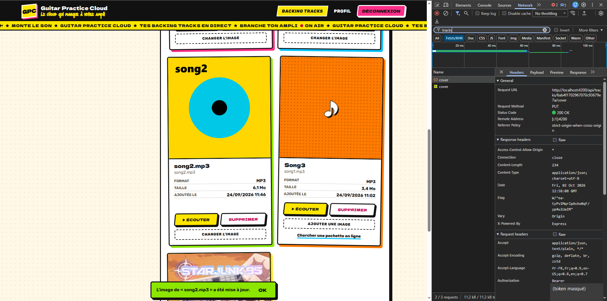

Ce que je sais maintenant expliquer sans l'agent

Pourquoi on identifie les changements de données et d'API avant de coder, pourquoi le type MIME envoyé par le client suffit pas et comment on vérifie la signature d'un fichier, pourquoi le SVG est dangereux, pourquoi une image protégée par JWT se charge comme l'audio (Blob et ObjectURL), et comment éviter les fichiers orphelins sur le serveur.

## AVANCÉ, image de couverture, deuxième approche

Objectif

Ajouter la deuxième approche des pochettes (tags ID3 et service web), en plus de l'upload manuel, sans changer les routes existantes.

Prompt principal

Au début j'avais écarté cette approche. Je suis revenu dessus plus tard, pendant le TP3, et j'ai demandé de la faire en plus, en gardant les mêmes règles de sécurité que l'upload manuel et en respectant les conditions d'utilisation du service externe.

Plan proposé par l'agent

Lire les tags avec music-metadata pendant le `POST /api/tracks`, deviner l'artiste et le titre depuis un nom "Artiste - Titre.mp3", ajouter une route `POST /api/tracks/:id/cover/lookup` qui passe par MusicBrainz puis Cover Art Archive (avec un User-Agent et une requête par seconde max), ajouter les champs `artist`, `album` et `coverSource`, et côté Angular un formulaire de recherche prérempli et un crédit sous l'image.

Vérifications réalisées par moi

J'ai testé avec mes vrais fichiers. coffee-time a eu sa pochette grâce aux tags ID3, et "Daft Punk - Get Lucky" a eu la sienne par la recherche web. Pour Beat_Keep_Rocking la recherche trouvait rien. J'ai été voir sur MusicBrainz et l'artiste s'appelle en fait "Starjunk 95" et le titre "Beat Keep Rockin'". Avec ces valeurs la bonne pochette a été trouvée.

Erreurs ou propositions rejetées

Une recherche automatique à l'aveugle a été écartée au profit d'un formulaire modifiable, justement à cause de cas comme Beat_Keep_Rocking où un seul caractère de différence fait tout rater. Et pour Get Lucky, la pochette trouvée est celle d'une compilation qui contient le morceau et pas l'album de Daft Punk, ce qui montre qu'un résultat avec un bon score peut quand même être une autre sortie du morceau.

Fichiers effectivement modifiés

Le nouveau `backend/src/metadata.js`, `backend/src/app.js`, `backend/src/models/Track.js`, `backend/package.json` (music-metadata), `backend/test/api.test.js`, le nouveau `backend/test/metadata.test.js`, `API_CONTRACT.md`, `track.model.ts`, `track.service.ts`, `tracks-page.ts/html/css` et les tests de TrackService et tracks-page.

Preuve de fonctionnement

Les tests de `metadata.test.js` passent (signature des images, nettoyage du texte, découpage du nom, vrai tag ID3 fabriqué par le test, recherche avec un faux fetch). Les captures ont été prises après le redesign du TP3, donc avec le nouveau design.

Ce que je sais maintenant expliquer sans l'agent

Ce que contient un tag ID3, pourquoi on vérifie l'image par ses premiers octets même quand elle vient du fichier audio, pourquoi il faut nettoyer ce qui vient d'un service externe, pourquoi MusicBrainz impose un User-Agent et une limite de requêtes, et pourquoi on garde un crédit pour les images trouvées sur le web.

# Rapport d'usage de l'IA, TP3

Modèle utilisé, Claude Opus 5.5 (`claude-opus-5-5`) via Claude Code.

Comme pour le TP2, les explications détaillées sont dans `TP3_MISSIONS.md`, et tout a été fait sur une branche `tp3` partie de main.

## Mission 5, suppression d'une piste

Objectif

Avoir une suppression propre avec confirmation, un SnackBar pour le résultat, la gestion du cas où la piste existe plus (404), une liste remise à jour après la suppression et pas de double envoi.

Prompt principal

J'ai gardé la même méthode qu'avant. D'abord regarder ce que j'avais déjà fait au TP2 avec les améliorations facultatives (la MatDialog et la suppression existaient déjà), ensuite compléter seulement ce que le sujet du TP3 demandait en plus, avec un commit par fonctionnalité.

Plan proposé par l'agent

Lire la route `DELETE` dans `app.js` pour savoir ce que le backend renvoie vraiment, remplacer le message texte par MatSnackBar, traiter le 404 comme "la piste est déjà plus là" en rechargeant la liste, reculer d'une page si on vide la dernière, et bloquer le double clic dans le composant en plus du bouton désactivé.

Vérifications réalisées par moi

J'ai vérifié dans le backend qu'il répond 404 aussi bien pour une piste supprimée que pour la piste de quelqu'un d'autre, et que c'est voulu pour pas laisser deviner les id. J'ai relu le code du composant avant de le garder, et la suppression est couverte par les tests de la mission 7. Pour le 404 j'ai supprimé une piste avec curl pendant qu'elle était encore affichée, comme si c'était dans un autre onglet, puis j'ai cliqué sur Supprimer dans la page.

Erreurs ou propositions rejetées

Rien de rejeté sur le fond. Le seul point discuté c'était le cas d'une erreur 500. On a choisi de recharger la liste quand même, parce que le backend peut avoir supprimé l'entrée en base avant de planter.

Fichiers effectivement modifiés

`tracks-page.ts` et `tracks-page.html`. Pas de changement backend.

Preuve de fonctionnement

Les tests du composant (suppression complète, 404 à la suppression, une seule requête DELETE même avec un deuxième clic) passent, et le build passe. Mes captures dans le navigateur, avec le token masqué.

Ce que je sais maintenant expliquer sans l'agent

Pourquoi la suppression passe par TrackService, pourquoi le guard et le fait de cacher le bouton protègent rien, comment le backend vérifie le JWT puis filtre sur le `ownerId` du token, et pourquoi il répond 404 et pas 403.

## Mission 6, progression de l'upload

Objectif

Avoir un état d'upload clair (idle, uploading, success, error), le formulaire bloqué pendant l'envoi, un pourcentage juste, et rien de sensible dans la console.

Prompt principal

La barre de progression existait déjà depuis le TP2, donc j'ai demandé de partir de ce qui était là et de corriger ce qui collait pas au sujet, sans tout refaire.

Plan proposé par l'agent

Remplacer les signaux éparpillés par un seul signal `uploadStatus`, faire de `uploading` un `computed()` pour qu'il soit jamais désynchronisé, désactiver le champ titre avec `disable()` pendant l'envoi, protéger le calcul du pourcentage quand `total` manque, et repasser sur tous les `console.debug` du composant.

Vérifications réalisées par moi

J'ai relu les changements d'état un par un pour vérifier qu'on revient bien en idle quand on choisit un nouveau fichier, et que le titre est réactivé aussi bien après un succès qu'après une erreur. J'ai aussi relu les logs pour vérifier qu'aucun token ou mot de passe passe dedans. Et j'ai testé dans le navigateur avec le réseau en Slow 4G dans les DevTools.

Erreurs ou propositions rejetées

Les tests passaient, mais en Slow 4G la barre restait à 0 % jusqu'à la fin de l'envoi. Avec Angular 22, HttpClient passe par fetch par défaut, et fetch donne aucun événement de progression à l'envoi. Les tests le voyaient pas parce que HttpTestingController simule les événements. On a corrigé en ajoutant `withXhr()` dans `main.ts`.

Fichiers effectivement modifiés

`tracks-page.ts`, `tracks-page.html` et `main.ts` (`withXhr()`).

Preuve de fonctionnement

Les tests de l'upload réussi (statut, titre désactivé, 25 % pour 30 octets sur 120) et de l'upload refusé passent. Après la correction le pourcentage monte petit à petit dans le navigateur en Slow 4G, et la requête est en xhr. Une fois fini, le POST répond 201 et le corps est bien en multipart.

Ce que je sais maintenant expliquer sans l'agent

Pourquoi avec `observe` à 'events' l'Observable émet plusieurs fois, ce que sont les événements Sent, UploadProgress et Response, comment on calcule le pourcentage avec `loaded` et `total`, pourquoi il faut XMLHttpRequest et pas fetch pour suivre un envoi, et pourquoi un `computed()` évite d'avoir deux signaux qui se contredisent.

## Mission 7, tests automatisés

Objectif

Mettre en place des tests frontend (au moins 3) et des tests backend sur le contrat HTTP, avec un rapport attendu et observé.

Prompt principal

J'ai demandé de configurer les tests Angular puis d'écrire des tests utiles plutôt que juste le minimum, sur les services, les intercepteurs, le guard et la page bibliothèque, et de compléter les tests backend sur les cas d'erreur du contrat.

Plan proposé par l'agent

Installer vitest et jsdom, créer `tsconfig.spec.json`, utiliser `HttpTestingController` pour simuler le backend, remplacer MatDialog et MatSnackBar par des faux dans le test du composant, et côté backend ajouter des tests qui marchent sans MongoDB parce que le serveur répond avant la base.

Vérifications réalisées par moi

Les deux suites ont été relancées pour le rapport et j'ai comparé ce que chaque test attend avec le comportement de l'appli. J'ai aussi vérifié que les messages attendus dans les tests backend sont exactement ceux de `API_CONTRACT.md`.

Erreurs ou propositions rejetées

Au début tous les tests liés au token plantaient. L'agent a trouvé que Node 26 a son propre `localStorage` qui vaut undefined et qui cache celui de jsdom, d'où le fichier `src/test-setup.ts`. En relançant tout pour le rapport, Vitest signalait une erreur non gérée dans le test de la pochette (le vrai `URL.createObjectURL` appelé dans jsdom). Les tests passaient quand même mais j'ai demandé de corriger, c'est maintenant un espion. Et comme dit dans la mission 6, ces tests simulent les événements de progression, donc ils ont pas vu le problème de fetch. C'est en testant dans le vrai navigateur que je l'ai trouvé.

Fichiers effectivement modifiés

`frontend-starter/package.json`, `angular.json`, `tsconfig.app.json`, le nouveau `tsconfig.spec.json`, `src/test-setup.ts`, six fichiers `.spec.ts` (AuthService, TrackService, les deux intercepteurs, le guard et tracks-page) et `backend/test/api.test.js`.

Preuve de fonctionnement

20 tests frontend sur 20 dans 6 fichiers, 19 tests backend sur 19, sans erreur non gérée, et `npm run build` passe. Le détail attendu et observé est dans `TP3_MISSIONS.md`.

Ce que je sais maintenant expliquer sans l'agent

Comment `HttpTestingController` intercepte les requêtes et à quoi servent `flush()`, `event()` et `verify()`, pourquoi les tests HTTP ont pas besoin de MongoDB, ce que vérifie un test d'intercepteur ou de guard, et la différence entre un test unitaire et un test d'intégration.

## Redesign et scène 3D

Objectif

Refaire le look du site sans rien casser, ajouter une scène 3D qui réagit à la musique, et garder un site rapide.

Prompt principal

J'ai demandé un vrai redesign. Après une première version, j'ai demandé de tout refaire avec une direction artistique précise, inspirée de Jet Set Radio, en reprenant juste le style et pas les logos ni les persos du jeu.

Plan proposé par l'agent

Mettre toutes les couleurs en variables CSS dans `styles.css`, choisir des polices qui collent au style, rebrancher les variables d'Angular Material sur les miennes, faire la scène avec Three.js et les modèles CC0 de Kenney, la passer en cel-shading avec MeshToonMaterial et OutlineEffect, et charger la 3D en différé avec `@defer` et des routes en `loadComponent`.

Vérifications réalisées par moi

Le rendu a été vérifié avec des captures du navigateur à chaque étape, c'est comme ça que j'ai vu que la première version allait pas. J'ai vérifié la licence des modèles, la taille des bundles après le build, et que les 20 tests front passaient toujours après le redesign.

Erreurs ou propositions rejetées

La première version était un thème sombre violet avec du néon. Je l'ai rejetée parce que ça faisait trop "site généré par une IA", c'est ce qui a mené à la version Jet Set Radio. J'ai aussi fait enlever le clavier et la souris de la scène 3D, ça chargeait des modèles pour rien.

Fichiers effectivement modifiés

`styles.css`, `index.html` (polices), `angular.json` (thème Material), `routes.ts` (loadComponent), `app.html` et `app.ts`, les templates et CSS des pages login, register, profile et tracks, `confirm-dialog.ts`, le nouveau composant `studio-scene` (avec `studio-world.ts`), le nouveau `audio-visualizer.service.ts`, `package.json` (Three.js) et les modèles dans `public/models` avec leur licence.

Preuve de fonctionnement

Build sans erreur ni warning, chargement initial d'environ 149 Ko compressé, Three.js dans un chunk séparé d'environ 134 Ko compressé.

Ce que je sais maintenant expliquer sans l'agent

Comment `loadComponent` et `@defer` découpent le JS en morceaux chargés au bon moment, comment marche le cel-shading (peu de tons et un contour dessiné derrière l'objet), comment un AnalyserNode donne le spectre de la musique en train de jouer, et pourquoi on arrête l'animation quand la scène est hors de l'écran.
