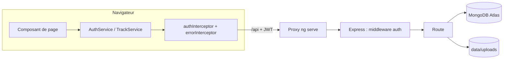
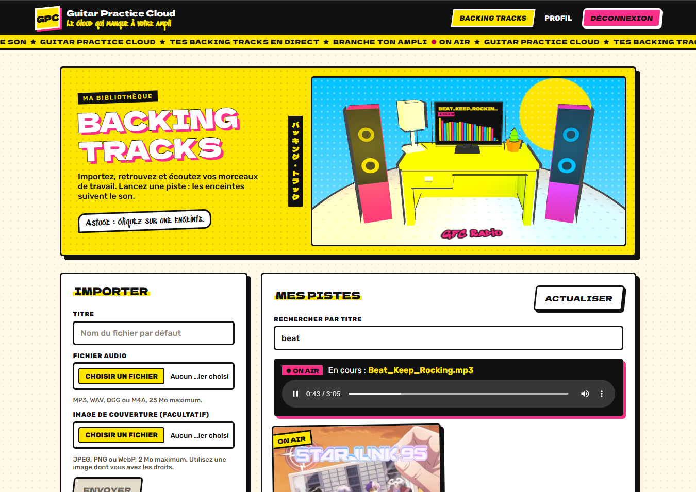
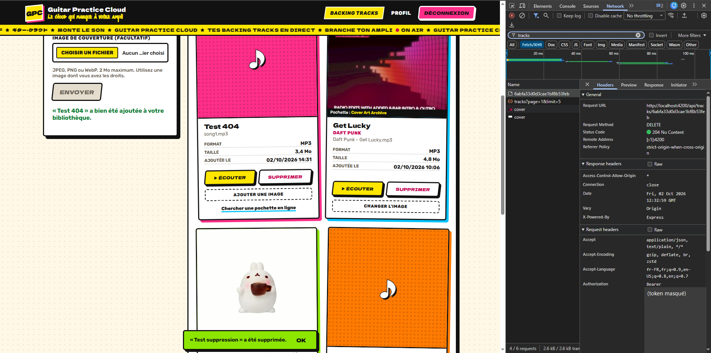
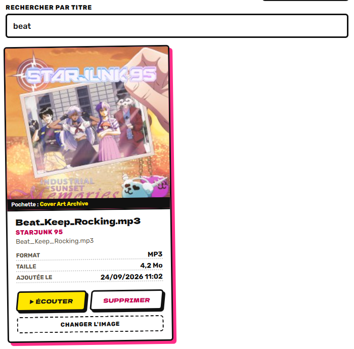

# Guitar Practice Cloud

Auteur, Loris Galland

Application web pour stocker et réécouter ses enregistrements de guitare. Chaque
utilisateur a son compte, envoie ses fichiers audio (MP3, WAV, OGG ou M4A, 25 Mo
maximum) et les retrouve dans une bibliothèque paginée avec lecture dans le
navigateur, recherche par titre, pochettes et suppression.

Le projet part du starter fourni pour le cours de Programmation Web (M1 MIAGE) et a
été construit au fil des trois TP.

| Partie | Technologies |
|---|---|
| Frontend | Angular 22 (composants standalone, signals), Angular Material, Three.js |
| Backend | Node.js 22, Express 5, Mongoose 9, Multer, JWT |
| Base de données | MongoDB Atlas (utilisateurs et métadonnées des pistes) |
| Fichiers audio | stockés sur le disque du serveur, dans `backend/data/uploads` |
| Tests | Vitest côté frontend, `node:test` côté backend |

## Lancer le projet

Il faut Node.js 22 ou plus récent et une base MongoDB Atlas. La création de la base
est décrite dans [ATLAS_SETUP.md](ATLAS_SETUP.md).

Backend, sur http://localhost:3000

```bash
cd backend
cp .env.example .env    # renseigner l'URI MongoDB Atlas et le secret JWT
npm install
npm start
```

Frontend, sur http://localhost:4200, dans un second terminal

```bash
cd frontend-starter
npm install
npm start
```

Le serveur de développement Angular redirige `/api` vers le backend grâce à
`proxy.conf.json`, il n'y a donc pas d'URL de backend à configurer côté Angular.

## Architecture

Le dépôt contient deux applications indépendantes qui ne communiquent que par
l'API HTTP décrite dans [API_CONTRACT.md](API_CONTRACT.md).



Côté frontend, les composants n'utilisent jamais `HttpClient` directement. Ils
passent par un service ([AuthService](frontend-starter/src/app/shared/services/auth.service.ts)
ou [TrackService](frontend-starter/src/app/shared/services/track.service.ts)). Le
token JWT est gardé dans un signal et dans le `localStorage`.
[authInterceptor](frontend-starter/src/app/shared/interceptors/auth.interceptor.ts)
l'ajoute à chaque requête, et
[errorInterceptor](frontend-starter/src/app/shared/interceptors/error.interceptor.ts)
déconnecte l'utilisateur et le renvoie vers `/login` quand le serveur répond 401.
Les pages protégées passent par [authGuard](frontend-starter/src/app/shared/guards/auth.guard.ts),
et chaque page est chargée à la demande avec `loadComponent`
([routes.ts](frontend-starter/src/app/routes.ts)).

Côté backend, tout est dans [app.js](backend/src/app.js). Le middleware `auth`
vérifie la signature et l'expiration du JWT. Chaque requête sur une piste filtre
ensuite sur l'`ownerId` tiré du token. Une piste qui appartient à un autre
utilisateur renvoie donc 404, comme une piste qui n'existe pas. MongoDB ne
contient que les utilisateurs et les métadonnées
([User](backend/src/models/User.js), [Track](backend/src/models/Track.js)). Multer
écrit les fichiers audio et les pochettes sur le disque.
[metadata.js](backend/src/metadata.js) lit les tags ID3, vérifie les images par leur
signature et cherche les pochettes sur MusicBrainz et Cover Art Archive.

```text
backend/
  src/
    server.js         démarrage, connexion MongoDB, compte de démonstration
    app.js            routes Express, middleware auth, configuration Multer
    metadata.js       tags ID3, détection d'images, recherche de pochette
    models/           schémas Mongoose User et Track
  test/               tests node:test (contrat de l'API, métadonnées)
frontend-starter/
  src/app/
    components/       pages login, register, profile, tracks et composant racine
    shared/
      services/       AuthService, TrackService, AudioVisualizerService
      interceptors/   ajout du JWT et gestion du 401
      guards/         authGuard
      components/     boîte de confirmation, scène 3D Three.js
      models/ pipes/ validators/
```

## Ce qui a été réalisé

Chaque mission est détaillée dans son compte rendu, et l'usage de l'assistant IA
dans le rapport IA.

### TP1

| Mission | Compte rendu | Rapport IA |
|---|---|---|
| Mission 0, comprendre le projet | [TP1](TP1_MISSIONS.md#mission-0-comprendre-comment-le-projet-est-fait) | [Mission 0](RAPPORT_IA_MODELE.md#mission-0-cartographie-de-lapplication) |
| Mission 1, inscription, connexion et profil | [TP1](TP1_MISSIONS.md#mission-1-inscription-connexion-et-profil), [checkpoint Network](TP1_MISSIONS.md#checkpoint-network) | [Mission 1](RAPPORT_IA_MODELE.md#mission-1-inscription-connexion-et-profil) |

### TP2

| Mission | Compte rendu | Rapport IA |
|---|---|---|
| Mission 2, bibliothèque paginée | [TP2](TP2_MISSIONS.md#mission-2-bibliothèque-paginée), [pagination Mongoose](TP2_MISSIONS.md#mission-2-avancé-pagination-mongoose), [Angular Material](TP2_MISSIONS.md#mission-2-avancé-angular-material) | [Mission 2](RAPPORT_IA_MODELE.md#mission-2-bibliothèque-paginée) |
| Mission 3, upload et lecture audio | [TP2](TP2_MISSIONS.md#mission-3-upload-et-lecture-audio), [mémoire et streaming](TP2_MISSIONS.md#mission-3-questions-sur-mémoire-buffering-et-streaming), [Blob et ObjectURL](TP2_MISSIONS.md#mission-3-pourquoi-blob-et-objecturl) | [Mission 3](RAPPORT_IA_MODELE.md#mission-3-upload-et-lecture-audio) |
| Améliorations facultatives | [TP2](TP2_MISSIONS.md#améliorations-facultatives) | [Améliorations](RAPPORT_IA_MODELE.md#améliorations-facultatives) |
| Image de couverture | [upload](TP2_MISSIONS.md#avancé-image-de-couverture), [ID3 et recherche web](TP2_MISSIONS.md#avancé-image-de-couverture-deuxième-approche) | [upload](RAPPORT_IA_MODELE.md#avancé-image-de-couverture), [ID3 et recherche web](RAPPORT_IA_MODELE.md#avancé-image-de-couverture-deuxième-approche) |

### TP3

| Mission | Compte rendu | Rapport IA |
|---|---|---|
| Mission 5, suppression d'une piste | [TP3](TP3_MISSIONS.md#mission-5-suppression-dune-piste) | [Mission 5](RAPPORT_IA_MODELE.md#mission-5-suppression-dune-piste) |
| Mission 6, progression de l'upload | [TP3](TP3_MISSIONS.md#mission-6-progression-de-lupload) | [Mission 6](RAPPORT_IA_MODELE.md#mission-6-progression-de-lupload) |
| Mission 7, tests automatisés | [TP3](TP3_MISSIONS.md#mission-7-tests-automatisés) | [Mission 7](RAPPORT_IA_MODELE.md#mission-7-tests-automatisés) |
| Refonte du site | [TP3](TP3_MISSIONS.md#redesign-du-site), [preuves](TP3_MISSIONS.md#les-preuves) | [Redesign et scène 3D](RAPPORT_IA_MODELE.md#redesign-et-scène-3d) |

## Aperçu







Toutes les captures sont rangées par TP dans [screenshots](screenshots).

## Tests

```bash
cd backend && npm test             # 19 tests node:test
cd frontend-starter && npm test    # 20 tests Vitest
```

Le détail de ce qui est testé est dans la [Mission 7 du TP3](TP3_MISSIONS.md#mission-7-tests-automatisés).

## Documents du dépôt

| Document | Contenu |
|---|---|
| [API_CONTRACT.md](API_CONTRACT.md) | Routes, formats échangés et codes d'erreur de l'API |
| [ATLAS_SETUP.md](ATLAS_SETUP.md) | Création de la base MongoDB Atlas |
| [TP1](TP1_MISSIONS.md), [TP2](TP2_MISSIONS.md), [TP3](TP3_MISSIONS.md) | Compte rendu des missions |
| [RAPPORT_IA_MODELE.md](RAPPORT_IA_MODELE.md) | Usage de l'assistant IA, mission par mission |
| [Sujets TP1](SUJET_ETUDIANT_TP1.md), [TP2](SUJET_ETUDIANT_TP2.md), [TP3](SUJET_ETUDIANT_TP3.md) | Énoncés des séances |
| [backend/best-practices.md](backend/best-practices.md), [frontend-starter/best-practices.md](frontend-starter/best-practices.md) | Conventions de code suivies dans chaque partie |

Les fichiers `.env`, `node_modules` et les fichiers uploadés ne sont pas versionnés.
Les fichiers audio de `frontend-starter/fichiers-audio-de-test/` servent aux essais.
