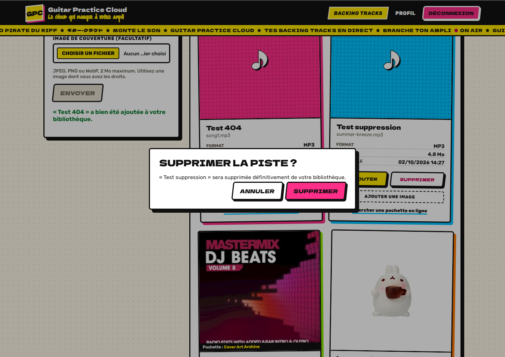
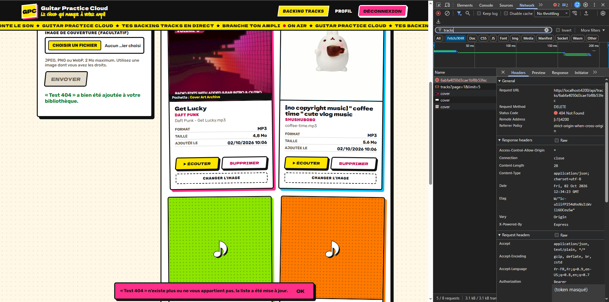
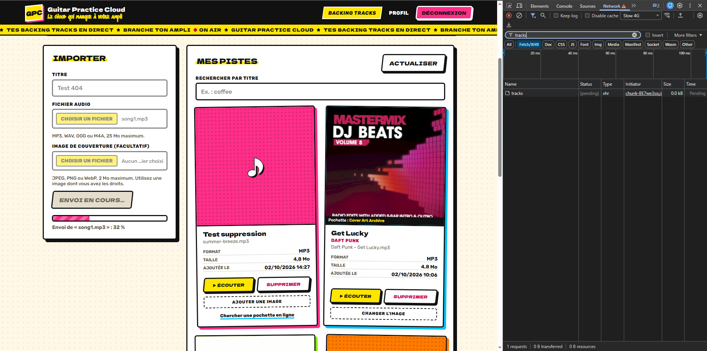
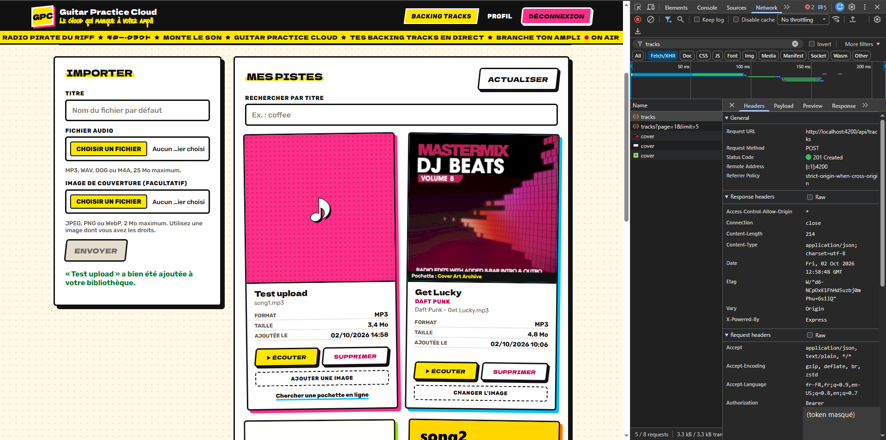
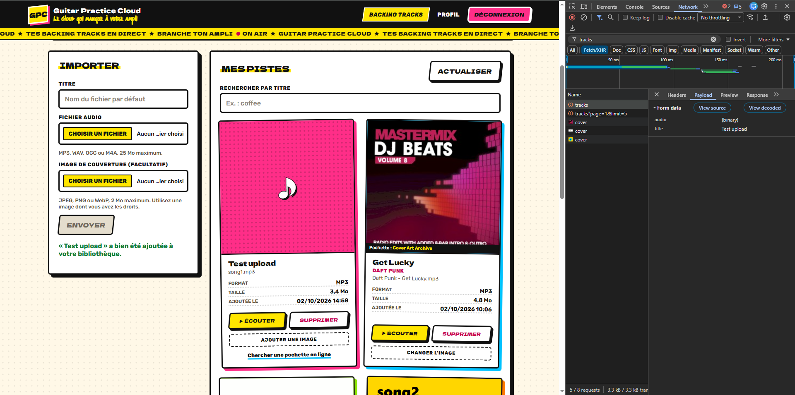

# TP3, mes missions

## Préparation

Comme pour le TP2, j'ai tout fait sur une branche à part, tp3, partie de main une fois le TP2 fusionné. Avant de toucher au code j'ai relu le sujet et regardé ce qui existait déjà, parce que j'avais pris un peu d'avance au TP2 avec les améliorations facultatives. La boîte de confirmation MatDialog pour la suppression et la barre de progression de l'upload étaient déjà là. Du coup pour les missions 5 et 6 le boulot c'était surtout de compléter ce qui manquait par rapport au sujet (SnackBar, cas du 404, états d'upload bien séparés) plutôt que de tout partir de zéro.

Côté tests, le starter avait rien de vraiment utilisable pour Angular, et le backend avait juste deux tests (santé et schémas) plus celui que j'avais ajouté au TP2 pour le plugin de pagination.

## Mission 5, suppression d'une piste

Ce qui était déjà là

Le flux existait déjà depuis le TP2. Quand on clique sur Supprimer dans une card, le composant tracks-page appelle this.service.remove(id), et c'est TrackService qui fait le http.delete sur /api/tracks/:id. Le composant touche jamais HttpClient directement. Il y avait aussi la confirmation avec ma ConfirmDialogComponent (MatDialog) et un signal deletingId qui désactive le bouton de la card pendant la requête.

Le SnackBar

Avant, le résultat de la suppression s'affichait dans un petit texte au dessus de la liste. Maintenant j'utilise MatSnackBar comme demandé. J'ai fait une méthode notify(message, isError) qui ouvre le SnackBar avec un bouton OK, 4 secondes pour un succès et 6 pour une erreur (on a besoin de plus de temps pour lire une erreur), et une classe CSS différente pour que l'erreur soit en rouge et le succès en vert.

Le double clic

deletingId était déjà là pour désactiver le bouton, mais j'ai rajouté une vérif dans remove() et dans delete(). Si une suppression est déjà en cours, on fait rien. Comme ça même si on arrive à cliquer deux fois avant que le bouton se grise, on n'ouvre pas deux boîtes de dialogue et on n'envoie pas deux DELETE.

La piste qui existe plus

C'est le cas où la piste est encore affichée mais a été supprimée entre temps, par exemple dans un autre onglet. J'ai été voir dans app.js ce que fait le backend. Il cherche la piste avec son id ET le ownerId du token. Si la piste existe pas ou si elle appartient à quelqu'un d'autre, dans les deux cas il répond 404 "Piste inconnue". Il fait exprès de pas répondre 403 pour une piste qui existe chez un autre, comme ça on peut pas deviner les id des pistes des autres.

Du coup côté front, sur un 404, je traite ça comme "la piste est de toute façon plus là". Je mets un message clair dans le SnackBar ("n'existe plus ou ne vous appartient pas, la liste a été mise à jour") et je recharge la liste. Pour les autres erreurs (500 par exemple) j'affiche le message du serveur et je recharge aussi, parce que le backend peut avoir supprimé l'entrée en base et planté sur le fichier, donc mieux vaut resynchroniser.

La mise à jour de la page

Après une suppression réussie ou un 404, la méthode afterRemoval() fait trois trucs. Si la piste supprimée était en train d'être lue, elle arrête la lecture et révoque l'ObjectURL. Si c'était la dernière piste d'une page autre que la première, elle recule d'une page, sinon on tomberait sur une page vide genre "Page 3 / 2". Et elle relance load() pour récupérer la vraie liste depuis le serveur.

Pourquoi le guard et l'interface suffisent pas

Le guard Angular et le fait de pas afficher le bouton, ça se passe dans le navigateur, donc chez l'utilisateur. N'importe qui peut ouvrir la console, modifier le code, ou carrément envoyer un DELETE avec curl ou Postman sans passer par Angular du tout. Le guard c'est juste du confort pour pas montrer une page à quelqu'un de pas connecté. La vraie sécurité c'est le backend. Le middleware auth vérifie la signature et l'expiration du JWT (401 sinon), et la requête Mongo filtre sur le ownerId qui vient du token (req.auth.sub), donc même avec un token valide on peut supprimer que ses propres pistes.

## Mission 6, progression de l'upload

Ce qui était déjà là

Au TP2 j'avais déjà fait la barre de progression en mettant reportProgress à true et observe à 'events' dans TrackService.upload(). Mais l'état était éclaté dans plusieurs signals (un booléen uploading, un message d'erreur, un message de succès) et on pouvait pas vraiment dire dans quel état on était.

Les quatre états

J'ai ajouté un type UploadStatus = 'idle' | 'uploading' | 'success' | 'error' et un signal uploadStatus. uploading est maintenant un computed() qui vaut juste uploadStatus() === 'uploading', comme ça il peut jamais être désynchronisé. Quand on choisit un nouveau fichier on repasse en idle, quand on clique sur Envoyer on passe en uploading avec la progression à 0, et à la fin c'est success ou error.

Pendant l'envoi

Le bouton Envoyer et le choix du fichier étaient déjà désactivés, mais le champ titre restait modifiable. Comme c'est un FormControl, je fais this.title.disable() au début et enable() à la fin (succès ou erreur). Et dans upload() il y a un return direct si uploading() est déjà vrai, donc pas de deuxième soumission possible même en appuyant sur Entrée.

Le calcul du pourcentage

Chaque événement HttpEventType.UploadProgress contient loaded (octets déjà envoyés) et total (taille du corps). Je fais Math.round(100 * loaded / total). Je vérifie que total existe parce qu'il peut manquer si le navigateur connaît pas la taille du corps, et dans ce cas on garde l'ancienne valeur au lieu d'afficher NaN.

Le bug trouvé en faisant les captures

En faisant la capture de l'upload avec le réseau en Slow 4G, la barre restait bloquée à 0 % puis passait direct à "ajoutée à votre bibliothèque". Dans l'onglet Network la requête était de type fetch et pas xhr. En fait avec Angular 22, HttpClient utilise fetch par défaut, et fetch sait pas suivre l'envoi du corps de la requête. Angular envoie donc jamais d'événement UploadProgress, même avec reportProgress à true. Mes tests passaient quand même parce que HttpTestingController simule les événements, il passe pas par le vrai backend HTTP. La correction c'est une ligne dans main.ts, j'ai ajouté withXhr() dans provideHttpClient(). Après ça le pourcentage monte bien petit à petit (0, 3, 6, 9 %…) et la requête apparaît en xhr. Les 20 tests passent toujours et le build aussi.

Rien de sensible dans la console

J'ai repassé les console.debug et console.error du composant. On log le nom du fichier, l'id de la piste ou le statut HTTP, mais jamais le token, le mot de passe ou l'objet de requête complet (qui contiendrait le header Authorization).

Pourquoi c'est pas une requête comme les autres

Avec une requête normale, l'Observable de HttpClient émet une seule fois, quand la réponse finale arrive. Là avec observe à 'events' il émet plein de fois. Il y a un événement Sent au départ, plusieurs UploadProgress pendant l'envoi, un ResponseHeader, et enfin le Response avec le corps (la piste créée). Du coup dans le next() faut regarder event.type à chaque fois et faire un truc différent selon le type, soit mettre à jour le pourcentage, soit traiter la réponse finale. Si on faisait comme une requête normale on prendrait le premier événement pour la réponse et on planterait. Et l'état "en cours" dure tout le temps du flux, pas juste un aller retour.

## Mission 7, tests automatisés

La mise en place

Angular 22 utilise Vitest pour ng test. J'ai installé vitest et jsdom (un faux DOM pour faire tourner les composants sans navigateur), et créé tsconfig.spec.json. J'ai eu un truc chiant avec Node 26, il a son propre localStorage global qui vaut undefined si on lui donne pas de fichier, et il cache celui de jsdom. Du coup tous les tests qui touchent au token plantaient. J'ai fait un petit fichier src/test-setup.ts qui met un localStorage en mémoire quand il manque.

Pour simuler le backend j'utilise provideHttpClientTesting() et HttpTestingController. En gros le vrai HttpClient est utilisé, mais au lieu de partir sur le réseau les requêtes sont interceptées, le test peut vérifier l'URL, la méthode, les paramètres et les headers, puis répondre ce qu'il veut avec flush() (une réponse) ou event() (un événement de progression). À la fin de chaque test http.verify() vérifie qu'il reste aucune requête pas attendue.

Les tests frontend

J'en ai écrit 20 au lieu des 3 minimum, répartis dans 6 fichiers.

Pour AuthService, login() envoie bien un POST sur /api/auth/login avec l'email et le mot de passe dans le corps et stocke le token reçu, et en cas de 401 aucun token est stocké.

Pour TrackService, list() envoie page et limit en paramètres, q est ajouté seulement quand on fait une recherche, remove() fait un DELETE sur /api/tracks/:id, upload() envoie un FormData avec reportProgress et remonte les événements de progression, et lookupCover() envoie artiste et titre en POST.

Pour authInterceptor, avec un token dans le localStorage la requête part avec le header Authorization qui contient Bearer et le token, sans token aucun header est ajouté.

Pour errorInterceptor, sur un 401 il déconnecte, redirige vers /login et laisse quand même passer l'erreur au composant, et sur un 404 il garde la session.

Pour authGuard, sans token il renvoie un UrlTree vers /login, avec un token il laisse passer.

Pour TracksPageComponent, c'est là que je teste le vrai comportement de la page. Le MatDialog est remplacé par un faux qui répond toujours "confirmé" et le MatSnackBar par un faux qui enregistre juste les messages. J'y teste l'erreur affichée quand la liste plante, la suppression complète, le 404 à la suppression, l'upload qui réussit, l'upload qui échoue, et la recherche de pochette (trouvée ou pas).

Les tests backend

J'ai ajouté 6 tests dans api.test.js, qui marchent sans MongoDB parce que le serveur répond avant de toucher à la base. Il y a 401 sans JWT, 401 avec un JWT signé avec un autre secret, 401 avec un JWT expiré, 400 pour un upload sans fichier, 400 pour un type MIME refusé, et 401 sur la recherche de pochette sans token. Pour les deux tests d'upload je signe un vrai JWT avec le secret de développement, comme ça on passe le middleware auth et c'est bien Multer qui refuse. Plus un fichier metadata.test.js pour les pochettes automatiques. Cette partie fait partie de l'AVANCÉ du TP2, donc je l'explique dans TP2_MISSIONS.md.

Le rapport des tests

Pour la suppression, j'attends qu'après confirmation il parte une seule requête DELETE sur /api/tracks/t1, même si je reclique pendant qu'elle tourne, puis un message "a été supprimée" dans le SnackBar, puis un nouveau GET de la liste, et que deletingId revienne à null. C'est ce que j'observe, le test passe, dialog.open est appelé une seule fois et la liste contient plus que t2.

Pour le 404 à la suppression, j'attends un message qui contient "n'existe plus" et une liste rafraîchie. Observé pareil.

Pour l'upload qui marche, j'attends que le statut passe à uploading et que le titre soit désactivé tout de suite, puis qu'avec un événement de progression loaded 30 sur total 120 le pourcentage vaille 25, puis success avec le titre réactivé. J'observe 25 pile, et les bons états.

Pour l'upload qui échoue (400 "Format audio non accepté"), j'attends le statut error, uploading à false, et le message du serveur affiché dans la page. Observé pareil.

Pour l'erreur de chargement (500 "Serveur indisponible"), j'attends le message dans l'élément role="alert". Observé.

Pour l'intercepteur, j'attends le header exact "Bearer " suivi du token quand il existe et pas de header sinon. Observé. Pour le guard, j'attends un UrlTree qui pointe sur /login sans token et true avec. Observé.

Côté backend j'attends les codes 401 et 400 avec les messages exacts du contrat ("Authentification requise", "Jeton invalide ou expiré", "Fichier audio requis"). Observé.

Au final les 20 tests front passent (6 fichiers) et les 19 tests backend aussi. En relançant tout pour ce rapport, Vitest m'a quand même signalé une erreur non gérée dans le test de la pochette trouvée. Le composant appelait le vrai URL.createObjectURL sur le Blob simulé, et jsdom sait pas faire ça. Les tests passaient mais c'était pas propre, donc j'ai remplacé createObjectURL par un espion dans ce test, et ça m'a permis en plus de vérifier que l'URL de la pochette est bien rangée dans le signal covers. Maintenant plus aucune erreur.

npm run build passe aussi sans erreur ni warning.

## Restitution orale

Pourquoi la suppression passe par un service ?

Parce que le composant doit s'occuper de l'affichage et des interactions (la confirmation, le SnackBar, le rechargement), pas de savoir quelle URL appeler ni comment. Si demain la route change, on modifie juste TrackService. Ça permet aussi de réutiliser remove() ailleurs, et surtout de tester séparément. Le test du service vérifie l'URL et la méthode, le test du composant vérifie ce qui se passe à l'écran.

Comment le backend protège la suppression ?

En deux étapes. D'abord le middleware auth, sans header Authorization ou avec un JWT mal signé ou expiré, c'est 401 direct. Ensuite la route cherche la piste avec un findOne sur l'id de la piste ET le ownerId pris dans le token, donc l'id de l'utilisateur vient du token vérifié et pas de ce que le client envoie. Si la piste est pas à lui, il la trouve pas et répond 404, comme si elle existait pas.

Comment Angular calcule le pourcentage d'upload ?

Il le calcule pas tout seul, c'est moi qui le calcule à partir des événements. Avec reportProgress à true, le navigateur suit l'envoi du corps de la requête avec xhr.upload (XMLHttpRequest) et Angular le transforme en événements HttpEventType.UploadProgress avec loaded et total. Le pourcentage c'est 100 * loaded / total arrondi. Il faut que HttpClient utilise XMLHttpRequest, d'où le withXhr() dans main.ts, parce qu'avec fetch (le choix par défaut maintenant) il y a aucun événement de progression à l'envoi.

Pourquoi les tests HTTP ont pas besoin de MongoDB ?

Côté front, HttpTestingController intercepte les requêtes avant qu'elles partent, donc il y a même pas de backend du tout, c'est le test qui répond. Ce qu'on teste c'est le code Angular, pas le serveur. Côté backend, les tests que j'ai ajoutés portent sur des cas où le serveur répond avant de faire une requête à la base (token manquant ou invalide, fichier absent, mauvais type). Le test démarre l'app Express sans se connecter à Mongo.

Ce que vérifie un test d'intercepteur ou de guard ?

Pour l'intercepteur, que la requête qui arrive au "réseau" a bien été modifiée comme prévu, donc le header Authorization avec le bon format quand il y a un token, rien sinon. Pour l'error interceptor, la réaction à un 401 (logout + redirection) et le fait qu'il touche pas aux autres erreurs. Pour le guard, sa décision, laisser passer ou rediriger vers /login, selon qu'il y a un token ou pas.

Différence entre un test unitaire et un test d'intégration ?

Un test unitaire teste un seul morceau isolé, en remplaçant tout ce qui l'entoure par des faux, par exemple TrackService avec un faux backend, ou parseFileName juste avec des chaînes. Un test d'intégration vérifie que plusieurs morceaux marchent ensemble pour de vrai. Mes tests backend dans api.test.js sont plutôt entre les deux. Ils lancent la vraie app Express avec ses middlewares (auth, Multer) et font de vraies requêtes HTTP, mais sans la base. Et le test du composant tracks-page est un peu d'intégration aussi, puisqu'il fait tourner ensemble le composant, son template, TrackService et HttpClient.

## Redesign du site

Au TP2 je m'étais dit que je referais le design plus tard, et vu que le TP3 demande de "faire évoluer l'application sans la casser", c'était le bon moment. J'ai complètement changé le look du site.

Le thème

J'avais d'abord fait un thème sombre avec du violet et du néon, mais franchement ça faisait trop "site généré par une IA", tout le monde a ce look là. Du coup j'ai tout refait avec une vraie direction artistique, inspirée de Jet Set Radio, le jeu Dreamcast avec les graffeurs en rollers à Tokyo. Je reprends juste le style, pas de logo ni de perso du jeu.

En gros c'est des couleurs pleines et bien saturées (jaune, magenta, cyan, vert, orange) sur un fond crème avec une trame de points comme dans les BD, des contours noirs épais partout, et des ombres dures décalées au lieu des ombres floues. Les boutons sont jaunes, un peu penchés, et ils "s'enfoncent" quand on clique. Les titres sont en lettres pleines avec un contour noir et une ombre, comme un logo. Les cards des pistes sont comme des stickers collés un peu de travers, chacune avec sa couleur, et elles se redressent au survol. Il y a aussi un bandeau jaune sous le menu qui défile comme une radio pirate, un texte vertical en katakana dans le bandeau de la bibliothèque façon enseigne de Tokyo, et un badge ON AIR sur la piste en lecture.

Pour les polices j'ai pris Dela Gothic One pour les titres (bien épaisse, et elle a aussi les caractères japonais), Rubik pour le texte parce que ça reste lisible, et Sedgwick Ave Display pour les petits tags à la bombe. Toutes les couleurs sont des variables CSS dans styles.css (--ink, --yellow, --magenta…), comme ça on change une couleur à un seul endroit. Pour le texte d'erreur et de succès j'ai pris des versions plus foncées (--danger, --success), parce que du magenta clair sur fond clair c'est pas assez lisible.

J'ai aussi passé Angular Material sur un thème clair (rose-red) et j'ai redirigé ses variables vers les miennes. Ça donne les mêmes polices, boîte de dialogue et SnackBar avec contour noir et ombre dure, SnackBar vert pour un succès et magenta pour une erreur. Ça règle au passage le bug que j'avais vu au TP2, le thème Material demandait la police Roboto mais elle était jamais chargée, donc le paginator et la boîte de dialogue s'affichaient en police serif.

Tout ça c'est que de l'affichage, j'ai rien changé au fonctionnement, et les 20 tests front passent toujours.

La scène 3D

Sur les pages connexion, inscription et bibliothèque il y a maintenant une petite scène 3D avec Three.js, avec un bureau de studio avec un écran, une lampe, une plante et deux enceintes. Comme Jet Set Radio est un des premiers jeux en cel-shading, je l'ai passée en rendu "dessin animé". Les matériaux ont que 3 tons (ombre, milieu, lumière) au lieu d'un dégradé, avec MeshToonMaterial, et OutlineEffect redessine les objets en noir un peu plus gros derrière pour faire les contours à l'encre. J'ai recoloré les meubles avec les couleurs du site, mis un ciel cyan avec un soleil jaune derrière, et un tag "GPC Radio" à la bombe sur le sol. Les modèles 3D viennent du Furniture Kit de Kenney, qui est en licence CC0 (j'ai mis la licence dans public/models). Les 5 modèles font environ 60 Ko en tout.

Le truc cool c'est que les enceintes bougent avec la musique. J'ai fait un AudioVisualizerService qui branche le lecteur audio de la page sur un AnalyserNode de la Web Audio API. Ça donne le spectre de fréquences de ce qui est vraiment en train de jouer. Les basses font pulser le gros haut-parleur, les aigus le petit, et l'écran 3D affiche le titre du morceau avec un égaliseur. Quand rien joue, les enceintes "respirent" doucement, et si on clique sur une enceinte ça joue un petit kick synthétisé. J'avais aussi mis un clavier et une souris sur le bureau mais je les ai enlevés, ça chargeait la scène pour rien.

L'optimisation

Three.js c'est lourd (le chunk fait environ 630 Ko, 132 Ko compressé), donc j'ai fait attention à ce que ça ralentisse pas le site. Toutes les routes utilisent maintenant loadComponent, donc chaque page est son propre fichier JS téléchargé seulement quand on y va. Et la scène est dans un bloc @defer (on viewport; prefetch on idle). Three.js est dans un chunk séparé, préchargé quand le navigateur a rien d'autre à faire, et affiché seulement quand le bloc est visible. En attendant il y a un placeholder en CSS. Au final le chargement initial c'est environ 147 Ko compressé, sans la 3D.

Dans la scène elle même, l'animation s'arrête quand le bloc sort de l'écran (IntersectionObserver) ou quand l'onglet est caché, la résolution est limitée à 1,5x même sur les écrans très denses (un écran 3x calculerait 9 fois plus de pixels pour rien), et à la destruction du composant tout est libéré sur le GPU. Si l'utilisateur a activé "réduire les animations" dans son système, la scène est dessinée une seule fois sans animation. Et si WebGL marche pas, le site fonctionne normalement avec juste le fond CSS.

## Les preuves

Les captures sont dans screenshots/tp3, prises sur le compte demo avec des pistes de test que j'ai supprimées pendant les captures. Le token est masqué dans les headers.

La boîte de confirmation avant la suppression.

Après la confirmation, le DELETE part sur /api/tracks/:id et répond 204, le SnackBar vert s'affiche et la liste est rechargée (la requête tracks?page=1 juste en dessous).

La même chose avec une piste que j'avais supprimée avant avec curl, comme si c'était dans un autre onglet. Le DELETE répond 404, le SnackBar est en magenta avec le message "n'existe plus", et la liste est rechargée quand même.

L'upload avec le réseau en Slow 4G, la barre est à 32 % et la requête est en xhr (pending).

Et le même upload une fois fini, sans ralentir le réseau. Le POST sur /api/tracks répond 201 Created, la liste est rechargée et la nouvelle piste apparaît en premier.

Dans l'onglet Payload on voit que c'est bien du multipart (Form data) avec le champ audio en binaire et le champ title.

La scène 3D pendant la lecture, l'écran affiche le titre et l'égaliseur, et la card a le badge ON AIR.

